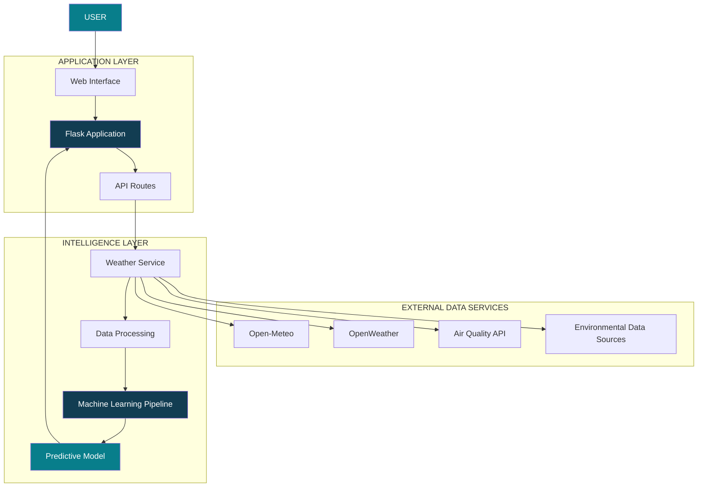

<div align="center">


<br/>


<br/><br/>

<a href="https://weathershield-afly.onrender.com/">

</a>

<a href="https://github.com/priyanshukumarverma091-hub/WeatherShield">

</a>

<br/><br/>


<br/><br/>

**A unified platform for weather intelligence, environmental awareness and predictive modeling.**

</div>

---

# 01 — The Vision

Weather is more than temperature and rainfall.

It is a continuously evolving system involving atmospheric conditions, geographical dependencies, environmental changes and extreme events.

**WeatherShield** is a Weather Intelligence System built to bring weather information, environmental insights and machine learning research into one platform.

The project combines a web-based weather application with a dedicated machine learning development pipeline.

Its long-term direction is to explore how predictive models and spatio-temporal learning architectures can contribute to more intelligent weather analysis.

<div align="center">


### OBSERVE → ANALYZE → PREDICT

*From environmental data to predictive intelligence.*

</div>

---

# 02 — Live Platform

<div align="center">

### EXPERIENCE WEATHERSHIELD

<a href="https://weathershield-afly.onrender.com/">


</a>

**Production Deployment**

https://weathershield-afly.onrender.com/

</div>

The deployed application provides a unified interface for exploring weather-related information and environmental conditions.

---

# 03 — Platform Capabilities

| Module | Description |
|:---|:---|
| Weather Intelligence | Access current weather information |
| Location Search | Explore weather by city |
| Location Support | Retrieve location-based weather information |
| Hourly Forecast | Explore hourly weather conditions |
| Extended Forecast | Access upcoming weather information |
| Air Quality Intelligence | Monitor environmental air-quality information |
| Weather Exploration | Interactive weather visualization |
| Emergency Interface | Emergency-related information and reporting interface |
| ML Research Pipeline | Develop and evaluate predictive weather models |

---

# 04 — System Architecture

WeatherShield follows a modular architecture that separates application logic, external data services and machine learning components.

<div align="center">



</div>

---

# 05 — Technology Stack

<div align="center">

### Backend & Application


### Machine Learning & Data Science


### Development & Deployment


</div>

| Category | Technologies |
|:---|:---|
| Programming | Python |
| Backend | Flask |
| Frontend | HTML, CSS, JavaScript |
| Weather Data | Open-Meteo, OpenWeather |
| Data Processing | Pandas, NumPy |
| Machine Learning | Scikit-learn |
| HTTP Communication | Requests |
| Configuration | python-dotenv |
| Deployment | Render |
| Version Control | Git, GitHub |

---

# 06 — Machine Learning Research Engine

<div align="center">


**Model First. Data Driven. Research Focused.**

</div>

WeatherShield includes a dedicated machine learning pipeline focused on developing and evaluating weather prediction models.

The research begins with a reliable baseline rather than immediately introducing complex architectures.

### Current Research Milestone

**Random Forest Regression — Temperature Prediction**

```text
Historical Weather Dataset
          |
          v
    Data Inspection
          |
          v
     Preprocessing
          |
          v
 Random Forest Regression
          |
          v
 Temperature Prediction
          |
          v
   Model Evaluation
          |
          +------ MAE
          |
          +------ RMSE
          |
          +------ R² Score
          |
          v
     Saved Model
```

### Model Development Structure

```text
weather_model/
│
├── model/
│   ├── __init__.py
│   ├── config.py
│   ├── preprocessing.py
│   ├── dataset.py
│   ├── model.py
│   ├── train.py
│   ├── evaluate.py
│   └── predict.py
│
├── data/
│   ├── raw/
│   │   └── weather.csv
│   └── processed/
│
├── saved_models/
│
├── requirements.txt
└── README.md
```

### Reproduce the Experiments

**Step 1 — Install dependencies**

```bash
pip install -r requirements.txt
```

**Step 2 — Train the model**

```bash
python -m model.train
```

**Step 3 — Evaluate performance**

```bash
python -m model.evaluate
```

**Step 4 — Test predictions**

```bash
python -m model.predict
```

### Evaluation Framework

| Metric | Purpose |
|:---|:---|
| MAE | Measures average absolute prediction error |
| RMSE | Penalizes larger prediction errors |
| R² Score | Measures explained variance |

The baseline will serve as a reference for future model comparisons.

---

# 07 — Research Roadmap

The long-term research direction is to investigate atmospheric patterns across space and time.

<div align="center">


</div>

| Phase | Research Direction |
|:---:|:---|
| 01 | Random Forest Regression |
| 02 | Time-Series Forecasting |
| 03 | Multi-Variable Weather Prediction |
| 04 | Severe-Weather Risk Classification |
| 05 | Cyclone Track Prediction |
| 06 | Spatio-Temporal Graph Neural Networks |
| 07 | GNN + LSTM / Transformer |
| 08 | Live Weather Intelligence Integration |

These are planned research directions, not claims of completed implementation.

### Long-Term Research Question

> Can spatial relationships, temporal dependencies and atmospheric patterns be learned together to improve the prediction and understanding of extreme weather events?

---

# 08 — Repository Structure

```text
WeatherShield/
│
├── app.py
│
├── backend/
│   ├── routes/
│   │   └── weather_routes.py
│   │
│   ├── services/
│   │   └── weather_service.py
│   │
│   ├── config.py
│   └── __init__.py
│
├── model/
│   ├── config.py
│   ├── dataset.py
│   ├── preprocessing.py
│   ├── model.py
│   ├── train.py
│   ├── evaluate.py
│   └── predict.py
│
├── data/
│   ├── raw/
│   └── processed/
│
├── saved_models/
│
├── templates/
│   └── index.html
│
├── requirements.txt
├── .env.example
├── .gitignore
└── README.md
```

---

# 09 — Run Locally

### Clone the Repository

```bash
git clone https://github.com/priyanshukumarverma091-hub/WeatherShield.git
```

### Enter the Project

```bash
cd WeatherShield
```

### Create Virtual Environment

```bash
python -m venv venv
```

### Activate Environment

**Windows**

```bash
venv\Scripts\activate
```

**Linux / macOS**

```bash
source venv/bin/activate
```

### Install Dependencies

```bash
pip install -r requirements.txt
```

### Configure Environment Variables

Create a `.env` file using `.env.example` as a reference.

```env
OPEN_METEO_BASE_URL=https://api.open-meteo.com/v1/forecast

OPEN_METEO_GEOCODING_URL=https://geocoding-api.open-meteo.com/v1/search

OPEN_METEO_AIR_QUALITY_URL=https://air-quality-api.open-meteo.com/v1/air-quality

OPENWEATHER_API_KEY=your_api_key_here

OPENWEATHER_BASE_URL=https://api.openweathermap.org/data/2.5
```

Never commit actual API keys or private credentials.

### Start Application

```bash
python app.py
```

Open:

```text
http://127.0.0.1:5000/
```

---

# 10 — Engineering Principles

WeatherShield follows a research-oriented development philosophy.

- **Reliability:** Establish working baselines before increasing complexity.
- **Reproducibility:** Keep experiments structured and measurable.
- **Modularity:** Separate backend services, application routes and ML components.
- **Validation:** Evaluate predictions using appropriate statistical metrics.
- **Security:** Keep sensitive credentials outside version control.
- **Scalability:** Design the architecture to accommodate future research components.

---

# 11 — Future Development

The project will continue evolving toward a more comprehensive weather intelligence system.

Potential extensions:

- Advanced atmospheric forecasting.
- Extreme-weather event detection.
- Spatial weather graph construction.
- Cyclone movement analysis.
- High-resolution weather modeling.
- Physics-informed machine learning.
- Multi-source environmental data fusion.

---

# 12 — Author

<div align="center">


### AI / ML Research Enthusiast

Interested in machine learning, deep learning, predictive systems and real-world AI research.

<a href="https://github.com/priyanshukumarverma091-hub">

</a>

<a href="https://priyanshu-portfolio-virid.vercel.app">

</a>

</div>

---

# 13 — Contributions

Contributions, research suggestions, technical discussions and improvements are welcome.

1. Fork this repository.
2. Create a feature branch.
3. Implement your changes.
4. Test your implementation.
5. Submit a pull request.

---

# 14 — License

This project is intended to be distributed under the MIT License. See the `LICENSE` file for the applicable terms.

---

<div align="center">


**UNDERSTAND THE ATMOSPHERE. BUILD FOR THE FUTURE.**

</div>
