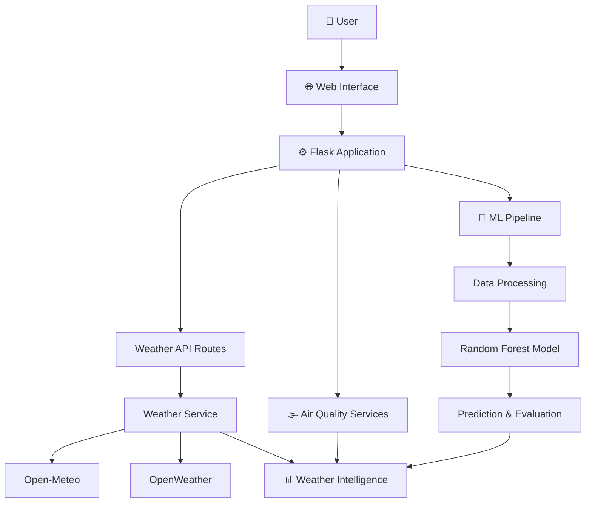

<div align="center">


<br/>

<a href="https://weathershield-afly.onrender.com/">

</a>


<br/><br/>

**A weather intelligence platform designed to make environmental information easier to access, understand, and act upon.**

</div>

---

## 🌍 About WeatherShield

WeatherShield is a web-based Weather Intelligence System that brings weather information, environmental insights, and weather prediction research into one platform.

It combines live weather data integrations with a modular Python backend and a machine learning development pipeline.

The goal is simple:

> Turn weather information into meaningful intelligence that helps people make better decisions.

Whether you want to explore weather conditions, monitor air quality, or understand upcoming forecasts, WeatherShield provides a unified interface for weather intelligence.

---

## ⚡ Core Capabilities

| Capability | Description |
|:---|:---|
| 🌤️ Weather Intelligence | Access current weather information. |
| 🔎 City Search | Explore weather information by location. |
| 📍 Location Support | Access weather using location functionality. |
| ⏱️ Hourly Forecast | Explore hourly weather forecasts. |
| 📅 Extended Forecast | View upcoming weather conditions. |
| 🌫️ Air Quality | Access air-quality information. |
| 🌎 Weather Exploration | Explore weather through an interactive interface. |
| 🚨 Emergency Interface | Access emergency-related information and reporting UI. |
| 🧠 ML Pipeline | Develop and evaluate weather prediction models. |

---

## 🖥️ Live Application

<div align="center">

### Experience WeatherShield

<a href="https://weathershield-afly.onrender.com/">


</a>

**Live Deployment:**  
https://weathershield-afly.onrender.com/

</div>

---

## 🏗️ System Architecture

WeatherShield follows a modular architecture that separates the application interface, backend services, and machine learning components.



---

## 🛠️ Technology Stack

<div align="center">

| Layer | Technologies |
|:---|:---|
| Backend | Python, Flask |
| Frontend | HTML, CSS, JavaScript |
| API Integration | Open-Meteo, OpenWeather |
| Environment Management | python-dotenv |
| HTTP Requests | Requests |
| Machine Learning | Scikit-learn |
| Data Processing | Pandas, NumPy |
| Model Development | Random Forest |
| Deployment | Render |
| Version Control | Git & GitHub |

</div>

---

## 📂 Project Structure

```text
WeatherShield/
│
├── backend/
│   ├── routes/
│   │   └── weather_routes.py
│   │
│   ├── services/
│   │   └── weather_service.py
│   │
│   └── config.py
│
├── model/
│   ├── config.py
│   ├── dataset.py
│   ├── preprocessing.py
│   ├── model.py
│   ├── train.py
│   ├── evaluate.py
│   └── predict.py
│
├── data/
│   ├── raw/
│   └── processed/
│
├── saved_models/
│
├── templates/
│   └── index.html
│
├── app.py
├── requirements.txt
├── .env.example
├── .gitignore
└── README.md
```

---

## 🚀 Getting Started

Want to explore or contribute to WeatherShield locally?

Follow these steps.

### 1. Clone the repository

```bash
git clone https://github.com/priyanshukumarverma091-hub/WeatherShield.git
```

### 2. Navigate to the project

```bash
cd WeatherShield
```

### 3. Create a virtual environment

```bash
python -m venv venv
```

Activate it:

**Windows**

```bash
venv\Scripts\activate
```

**Linux / macOS**

```bash
source venv/bin/activate
```

### 4. Install dependencies

```bash
pip install -r requirements.txt
```

### 5. Configure environment variables

Create a `.env` file in the root directory.

```env
OPEN_METEO_BASE_URL=https://api.open-meteo.com/v1/forecast

OPEN_METEO_GEOCODING_URL=https://geocoding-api.open-meteo.com/v1/search

OPEN_METEO_AIR_QUALITY_URL=https://air-quality-api.open-meteo.com/v1/air-quality

OPENWEATHER_API_KEY=your_api_key_here

OPENWEATHER_BASE_URL=https://api.openweathermap.org/data/2.5

IMD_API_KEY=

IMD_API_BASE_URL=https://api.imd.gov.in

NASA_EONET_URL=https://eonet.gsfc.nasa.gov/api/v3/events

GDACS_API_BASE_URL=https://www.gdacs.org/gdacsapi
```

**Security:** Never commit your actual `.env` file or API credentials to GitHub.

### 6. Run the application

```bash
python app.py
```

Open your browser:

```text
http://127.0.0.1:5000/
```

---

## 🔌 API Endpoints

The Flask application exposes the following routes:

| Endpoint | Purpose |
|:---|:---|
| `/` | Main application interface |
| `/health` | Application health check |
| `/api/status` | Application status |
| `/api/weather?city=Jaipur` | Weather information |
| `/api/air-quality?city=Jaipur` | Air-quality information |

---

## 🧠 Machine Learning Pipeline

WeatherShield also includes a dedicated machine learning development module.

The current baseline workflow:

```text
Historical Weather Dataset
          |
          ▼
    Data Loading
          |
          ▼
    Preprocessing
          |
          ▼
  Random Forest Model
          |
          ▼
  Temperature Prediction
          |
          ▼
  Model Evaluation
          |
          ▼
   Saved Model
```

### Model Commands

Train:

```bash
python -m model.train
```

Evaluate:

```bash
python -m model.evaluate
```

Test prediction:

```bash
python -m model.predict
```

The Random Forest implementation is the baseline model for the prediction pipeline, not a claim of production-grade weather forecasting accuracy.

---

## 🔭 Future Research & Development

WeatherShield is designed with room for further development.

Potential research directions include:

- 🌪️ Severe Weather Risk Classification
- 🌀 Cyclone Track Prediction
- 📈 Advanced Time-Series Forecasting
- 🧠 GNN-Based Weather Intelligence
- 🔬 Spatio-Temporal Deep Learning
- 🌧️ Extreme Weather Event Detection
- 🌍 High-Resolution Weather Prediction
- 🚨 Advanced Emergency Intelligence

These are development directions, not all currently implemented features.

---

## 🔐 Security

Security is an important part of the project.

- API keys are managed through environment variables.
- Sensitive configuration files should remain outside version control.
- `.env.example` provides a template without real credentials.

---

## 👨‍💻 Project Author

<div align="center">

### Priyanshu Kumar Verma

AI/ML Research Enthusiast | Developer

Building intelligent systems that address real-world problems through AI, machine learning, and software engineering.

<a href="https://github.com/priyanshukumarverma091-hub">

</a>

<a href="https://priyanshu-portfolio-virid.vercel.app">

</a>

</div>

---

## 🤝 Contributions

Ideas, suggestions, bug reports, and improvements are welcome.

If you find something interesting or want to improve WeatherShield:

1. Fork the repository.
2. Create a feature branch.
3. Make your changes.
4. Submit a pull request.

---

## 📜 License

This project is licensed under the MIT License.

See the `LICENSE` file for details.

---

<div align="center">


### 🌦️ WeatherShield

**Making Weather Intelligence More Accessible.**

*Understand the atmosphere. Prepare for tomorrow.*

</div>
