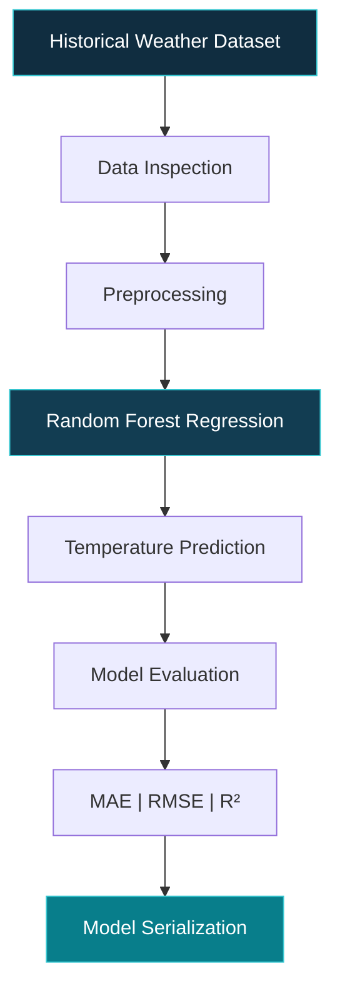

<div align="center">


# WEATHER INTELLIGENCE ENGINE

### Machine Learning Research & Predictive Modeling


**A model-first research pipeline for understanding and predicting atmospheric conditions.**

</div>

---

## 01 / Research Overview

WeatherShield incorporates a dedicated machine learning pipeline designed to evolve from conventional weather regression toward advanced spatio-temporal intelligence.

The research follows a progressive methodology:

- Establish a reproducible baseline.
- Validate model performance using statistical metrics.
- Investigate temporal and multivariate dependencies.
- Explore deep learning architectures for extreme-weather prediction.

**Current milestone:** Random Forest Regression for temperature prediction.

## 02 / Baseline Architecture

<div align="center">



</div>

## 03 / Research Implementation

```text
weather_model/
│
├── model/
│   ├── __init__.py
│   ├── config.py
│   ├── preprocessing.py
│   ├── dataset.py
│   ├── model.py
│   ├── train.py
│   ├── evaluate.py
│   └── predict.py
│
├── data/
│   ├── raw/
│   │   └── weather.csv
│   └── processed/
│
├── saved_models/
│
├── requirements.txt
└── README.md
```

## 04 / Reproducible Experiments

**Environment Setup**

```bash
pip install -r requirements.txt
```

**Model Training**

```bash
python -m model.train
```

**Performance Evaluation**

```bash
python -m model.evaluate
```

**Prediction Testing**

```bash
python -m model.predict
```

## 05 / Evaluation Framework

Model performance is assessed through established regression metrics.

| Metric | Evaluation Objective |
|:---|:---|
| MAE | Average absolute prediction error |
| RMSE | Penalization of larger prediction errors |
| R² Score | Proportion of target variance explained |

Model complexity will only increase when experiments demonstrate a meaningful improvement over the baseline.

## 06 / Research Trajectory

<div align="center">


</div>

| Research Stage | Direction |
|:---|:---|
| 01 | Random Forest Regression |
| 02 | Time-Series Forecasting |
| 03 | Multi-Variable Weather Prediction |
| 04 | Severe-Weather Risk Classification |
| 05 | Cyclone Track Prediction |
| 06 | Spatio-Temporal Graph Neural Networks |
| 07 | GNN + LSTM / Transformer Architectures |
| 08 | Live Weather Intelligence Integration |

These stages represent the research roadmap, not a claim that every capability is already implemented.

## 07 / Long-Term Research Vision

The long-term objective is to investigate atmospheric dependencies across both space and time.

Potential research directions include:

- Graph-based spatial weather representations.
- Temporal modeling of atmospheric evolution.
- Extreme-weather event detection.
- High-resolution predictive modeling.
- Integration of observational and forecast datasets.

The central research question:

> How can spatial relationships, temporal dependencies, and physical atmospheric patterns be combined to improve predictive weather intelligence?

---

<div align="center">


**WEATHER INTELLIGENCE ENGINE**

*Reliable Baselines. Measurable Progress. Advanced Research.*

</div>
